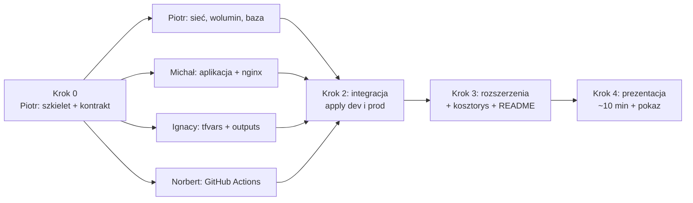

# Plan projektu — iac-projekt (temat 5, OpenTofu)

## 1. Podział odpowiedzialności

| Osoba | GitHub | Minimum (ocena dostateczna) | Rozszerzenie | Część README |
|---|---|---|---|---|
| **Piotr Ludkowski** | @RockooAC | szkielet `infra/` (provider, kontrakt zmiennych), **sieć**, **wolumin**, kontener **PostgreSQL** z danymi na woluminie, hasło przez `TF_VAR_db_password` | **pokaz dryfu i jego naprawy** w README | Architektura, Bezpieczeństwo, Sprzątanie zasobów |
| **Michał Świercz** | @Swierszczykowaty | kontener **aplikacji** (Adminer, `count` kopii), kontener **nginx** jako jedyny wystawiony na zewnątrz, konfiguracja `upstream` | **moduł wielokrotnego użytku** `modules/aplikacja` | opis warstwy aplikacji i proxy w Architekturze |
| **Ignacy Zieliński** | @ignacyzielinski | wartości zmiennych `dev.tfvars` / `prod.tfvars`, **wyniki** (`outputs.tf`), testy obu środowisk | **obszary robocze** (*workspaces*) `dev` i `prod` | Jak uruchomić (krok po kroku) |
| **Norbert Ostrowski** | @Norbert935 | **GitHub Actions**: `tofu fmt -check` + `tofu validate`, **kosztorys** z AWS Pricing Calculator | `tofu plan` w przepływie pracy z wynikiem w podsumowaniu + **szkic AWS** (`aws-szkic/`) sprawdzany `tofu validate` | Odpowiedniki u dostawców i kosztorys |

Każdy pracuje głównie w **swoich plikach**, więc praca równoległa nie powoduje konfliktów, a autorstwo widać w historii zatwierdzeń.

## 2. Docelowa struktura repozytorium

```
.
├── .github/workflows/tofu.yml     # Norbert
├── .gitignore                     # gotowe
├── README.md                      # wszyscy (każdy swoją sekcję)
├── PLAN.md                        # ten plik
├── ODPOWIEDZI.md                  # zadania wstępne (gotowe)
├── cwiczenie1/  web/              # zadania wstępne (gotowe)
├── infra/
│   ├── versions.tf                # Piotr   — terraform{} + provider docker
│   ├── variables.tf               # Piotr   — KONTRAKT zmiennych (krok 0)
│   ├── siec.tf                    # Piotr   — docker_network + docker_volume
│   ├── baza.tf                    # Piotr   — obraz + kontener postgres
│   ├── aplikacja.tf               # Michał  — obraz + kontener(y) adminer
│   ├── proxy.tf                   # Michał  — obraz + kontener nginx
│   ├── nginx.conf.tftpl           # Michał  — szablon konfiguracji nginx
│   ├── outputs.tf                 # Ignacy
│   ├── dev.tfvars                 # Ignacy
│   ├── prod.tfvars                # Ignacy
│   └── modules/aplikacja/         # Michał  — rozszerzenie
└── aws-szkic/                     # Norbert — rozszerzenie (tylko validate)
```

## 3. Kontrakt — wspólne nazwy (ustalone z góry, nie zmieniamy bez uzgodnienia)

**Zmienne** (`infra/variables.tf`):

| Zmienna | Typ | Domyślnie | Opis |
|---|---|---|---|
| `srodowisko` | string | — | `dev` / `prod`, przedrostek wszystkich nazw |
| `port_zewnetrzny` | number | — | port nginx na hoście (jedyny otwarty) |
| `liczba_kopii` | number | `1` | liczba kontenerów aplikacji |
| `obraz_postgres` | string | `postgres:16-alpine` | obraz bazy |
| `obraz_aplikacja` | string | `adminer:4` | obraz aplikacji |
| `obraz_proxy` | string | `nginx:alpine` | obraz proxy |
| `db_nazwa` | string | `app` | nazwa bazy |
| `db_uzytkownik` | string | `app` | użytkownik bazy |
| `db_password` | string, `sensitive = true` | **brak** | **tylko** z `export TF_VAR_db_password=...` |

**Zasoby** (adresy w OpenTofu → nazwa w Dockerze):

| Zasób | Nazwa w Dockerze | Właściciel |
|---|---|---|
| `docker_network.siec` | `<srodowisko>-siec` | Piotr |
| `docker_volume.dane` | `<srodowisko>-dane` | Piotr |
| `docker_container.baza` | `<srodowisko>-baza` | Piotr |
| `docker_container.aplikacja[*]` | `<srodowisko>-app-1..n` | Michał |
| `docker_container.proxy` | `<srodowisko>-proxy` | Michał |

**Wartości środowisk**:

| | `dev.tfvars` | `prod.tfvars` |
|---|---|---|
| `srodowisko` | `dev` | `prod` |
| `port_zewnetrzny` | `8080` | `8090` |
| `liczba_kopii` | `1` | `3` |

## 4. Kolejność prac



| Krok | Kto | Co | Gotowe, gdy |
|---|---|---|---|
| **0** | Piotr | `infra/versions.tf` + `infra/variables.tf` (pełny kontrakt) + puste pliki właścicieli | `tofu init && tofu validate` w `infra/` przechodzi |
| **1** | wszyscy równolegle | każdy swoje pliki (sekcja 5) | PR z zielonym CI |
| **2** | Ignacy (koordynuje), wszyscy | `apply` dev i prod, test w przeglądarce, `destroy` | Adminer pod `http://localhost:8080` loguje się do bazy |
| **3** | wszyscy | rozszerzenia + swoje sekcje README + kosztorys | README da się wykonać od zera |
| **4** | wszyscy | slajdy + pokaz: apply → przeglądarka → dryf → naprawa → destroy | próba generalna przeszła |

## 5. Zadania szczegółowo

### Piotr — szkielet, sieć, wolumin, baza

1. **Krok 0** — `infra/versions.tf`:
   ```hcl
   terraform {
     required_providers {
       docker = { source = "kreuzwerker/docker", version = "~> 3.0" }
     }
   }

   provider "docker" {}
   ```
   oraz `infra/variables.tf` z całym kontraktem z sekcji 3 i puste pliki `siec.tf`, `baza.tf`, `aplikacja.tf`, `proxy.tf`, `outputs.tf`. Commit + push na `main`, żeby reszta mogła startować.
2. `siec.tf`: `docker_network.siec` i `docker_volume.dane` z nazwami `"${var.srodowisko}-siec"` / `"${var.srodowisko}-dane"`.
3. `baza.tf`: `docker_image.postgres` + `docker_container.baza`:
   - `env = ["POSTGRES_DB=${var.db_nazwa}", "POSTGRES_USER=${var.db_uzytkownik}", "POSTGRES_PASSWORD=${var.db_password}"]`,
   - `volumes { volume_name = docker_volume.dane.name, container_path = "/var/lib/postgresql/data" }`,
   - `networks_advanced { name = docker_network.siec.name }`,
   - **bez** bloku `ports`.
4. Sprawdzenie, że dane przeżywają usunięcie kontenera (`docker rm -f dev-baza` → `tofu apply` → dane nadal są).
5. **Rozszerzenie**: sekcja *Dryf i jego naprawa* w README (ręczne `docker rm -f`, `tofu plan` pokazuje `+ create`, `tofu apply` naprawia — z fragmentami wyników).
6. README: Architektura (aktualizacja schematu), Bezpieczeństwo, Sprzątanie zasobów.

### Michał — aplikacja i nginx

1. `aplikacja.tf`: `docker_image.aplikacja` + `docker_container.aplikacja` z `count = var.liczba_kopii`:
   - `name = "${var.srodowisko}-app-${count.index + 1}"`,
   - `env = ["ADMINER_DEFAULT_SERVER=${docker_container.baza.name}"]`,
   - w sieci `docker_network.siec`, **bez** `ports`.
2. `nginx.conf.tftpl`: blok `upstream aplikacja { server <nazwa>:8080; ... }` generowany pętlą z listy nazw kontenerów aplikacji + `proxy_pass http://aplikacja;`.
3. `proxy.tf`: `docker_image.proxy` + `docker_container.proxy`:
   - plik konfiguracyjny wstrzyknięty blokiem `upload { content = templatefile("${path.module}/nginx.conf.tftpl", {...}), file = "/etc/nginx/conf.d/default.conf" }`,
   - `ports { internal = 80, external = var.port_zewnetrzny }` — **jedyny** blok `ports` w całym projekcie.
4. **Rozszerzenie**: przeniesienie aplikacji do `infra/modules/aplikacja` (wejścia: `srodowisko`, `liczba_kopii`, `obraz`, `siec`, `serwer_bazy`; wyjście: lista nazw) i użycie `module "aplikacja"`.
5. README: opis warstwy aplikacji i proxy.

### Ignacy — zmienne środowisk i wyniki

1. `dev.tfvars` i `prod.tfvars` zgodnie z sekcją 3 (**bez** hasła!).
2. `outputs.tf`:
   - `adres` = `"http://localhost:${var.port_zewnetrzny}"`,
   - `siec`, `wolumin`, `baza`, `aplikacja` (lista), `proxy` — nazwy utworzonych zasobów.
3. Krok 2 — test integracyjny obu środowisk:
   ```bash
   export TF_VAR_db_password='...'
   tofu apply -var-file=dev.tfvars   # -> http://localhost:8080
   tofu destroy -var-file=dev.tfvars
   tofu apply -var-file=prod.tfvars  # -> http://localhost:8090, 3 kopie
   tofu destroy -var-file=prod.tfvars
   ```
4. **Rozszerzenie**: obszary robocze — `tofu workspace new dev` / `new prod`, każde środowisko ma osobny stan, więc dev i prod mogą działać jednocześnie.
5. README: Jak uruchomić (krok po kroku, sprawdzone na czystym Codespace).

### Norbert — CI i kosztorys

1. `.github/workflows/tofu.yml` — przy każdym `push` i `pull_request`, dla katalogów `cwiczenie1`, `web`, `infra`:
   `opentofu/setup-opentofu@v1` → `tofu fmt -check -recursive` → `tofu init -backend=false` → `tofu validate`.
2. Kosztorys: [AWS Pricing Calculator](https://calculator.aws/), region **eu-central-1**, wariant `prod`:
   RDS PostgreSQL db.t4g.micro + 20 GB gp3, ECS Fargate 3 × (0,25 vCPU / 0,5 GB), Application Load Balancer, ECR ~1 GB.
   **Save and share** → link i suma miesięczna do README.
3. **Rozszerzenie A**: krok `tofu plan -var-file=dev.tfvars -no-color` w workflow (z `TF_VAR_db_password` z sekretu repozytorium `DB_PASSWORD_CI`), wynik dopisany do `$GITHUB_STEP_SUMMARY`.
4. **Rozszerzenie B**: `aws-szkic/` — ta sama architektura z providerem `hashicorp/aws` (VPC, EBS / RDS, ECS, ALB), **bez wykonywania**, dodany do macierzy `tofu validate`.
5. README: Odpowiedniki u dostawców i kosztorys (uzupełnienie kwot).

## 6. Zasady pracy w repozytorium

- Każdy pracuje na **swojej gałęzi** i wystawia **pull request** do `main`; CI musi być zielone przed scaleniem.
  ```bash
  git checkout main && git pull
  git checkout -b <imie>/<temat>        # np. piotr/baza, michal/proxy
  # ... praca ...
  tofu fmt -recursive && tofu validate
  git add <swoje pliki> && git commit -m "Konkretny opis zmiany"
  git push -u origin <imie>/<temat>     # potem PR na GitHubie
  ```
- **Nigdy** nie commitujemy `*.tfstate*`, `.terraform/` ani haseł (`.gitignore` to pilnuje — sprawdzać `git status` przed commitem).
- Opisy zatwierdzeń po polsku, konkretne: *„Dodanie kontenera PostgreSQL z woluminem”*, nie *„poprawki”*.
- Po pracy: **Stop codespace** (limit 60 h/mies. na osobę).

## 7. Checklista oddania

- [ ] `infra/` tworzy sieć, wolumin, Postgres (dane na woluminie), Adminer, nginx (jedyny port)
- [ ] `dev.tfvars` i `prod.tfvars` z różnymi portami, liczbą kopii i przedrostkiem
- [ ] outputs: adres + nazwy zasobów
- [ ] `.gitignore`, hasło tylko z `TF_VAR_db_password`
- [ ] GitHub Actions: `fmt -check` + `validate` — zielone
- [ ] README: wszystkie 7 sekcji, schemat Mermaid, kosztorys z linkiem do kalkulatora
- [ ] rozszerzenia: dryf (Piotr), moduł (Michał), workspaces (Ignacy), plan w CI + szkic AWS (Norbert)
- [ ] prezentacja ~10 min + pokaz działania
