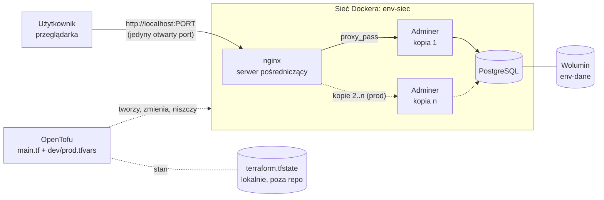

# iac-projekt — Infrastruktura jako kod (OpenTofu)

Projekt semestralny, **temat 5** z przedmiotu *Wprowadzenie do przetwarzania w chmurze*, semestr zimowy 2026/2027, Akademia Finansów i Biznesu Vistula.

## Cel projektu

Opisać w kodzie kompletne, wielowarstwowe środowisko aplikacji webowej (sieć, wolumin, baza danych, aplikacja, serwer pośredniczący). **OpenTofu** tworzy je, zmienia i niszczy jednym poleceniem, w dwóch wariantach: deweloperskim (`dev`) i produkcyjnym (`prod`).

Dostawcą infrastruktury jest **Docker** w GitHub Codespaces. Zamiast maszyn wirtualnych w chmurze powstają kontenery, ale język (HCL), plan, stan, dryf i cykl `init → plan → apply → destroy` są takie same jak u dostawcy chmurowego. Na końcu pokazujemy, czym te zasoby byłyby w AWS i ile by kosztowały.

Wymagania minimalne (ocena dostateczna):

- [ ] konfiguracja OpenTofu tworząca **sieć** Dockera, **wolumin**, kontener **bazy danych** (PostgreSQL) z danymi na woluminie, kontener **aplikacji** (Adminer) i kontener **serwera pośredniczącego** (nginx), który jako jedyny jest wystawiony na zewnątrz,
- [ ] **zmienne** z dwoma zestawami wartości: `dev.tfvars` i `prod.tfvars` (porty, liczba kopii aplikacji, przedrostek nazw),
- [ ] **wyniki** (*outputs*): adres, pod którym działa całość, i nazwy utworzonych zasobów,
- [x] `.gitignore` bez stanu i katalogu `.terraform/`; hasło bazy podawane przez zmienną środowiskową, nie w kodzie,
- [ ] GitHub Actions sprawdzający przy każdym `push` `tofu fmt -check` i `tofu validate`,
- [ ] sekcja *Odpowiedniki u dostawców i kosztorys*.

Planowane rozszerzenia: moduł wielokrotnego użytku, pokaz dryfu i jego naprawy, `tofu plan` w GitHub Actions z wynikiem w podsumowaniu, szkic tej samej infrastruktury dla AWS sprawdzony przez `tofu validate`.

## Skład zespołu i podział pracy

| Osoba | GitHub | Odpowiada za |
|---|---|---|
| Piotr Ludkowski | [@RockooAC](https://github.com/RockooAC) | *do uzupełnienia* |
| *imię i nazwisko* | [@Swierszczykowaty](https://github.com/Swierszczykowaty) | *do uzupełnienia* |
| *imię i nazwisko* | [@ignacyzielinski](https://github.com/ignacyzielinski) | *do uzupełnienia* |
| Norbert Ostrowski | [@Norbert935](https://github.com/Norbert935) | *do uzupełnienia* |

Zadania wstępne 5.1–5.4 wykonaliśmy wspólnie. Kolejne zadania widać w historii zatwierdzeń (*commits*).

## Architektura



| Element | Zasób OpenTofu | Rola |
|---|---|---|
| Sieć | `docker_network` | izolowana sieć, w której kontenery widzą się po nazwach |
| Wolumin | `docker_volume` | trwałe dane bazy, przeżywają usunięcie kontenera |
| Baza danych | `docker_container` (postgres) | PostgreSQL, bez portu na zewnątrz, hasło ze zmiennej `TF_VAR_db_password` |
| Aplikacja | `docker_container` (adminer, `count`) | panel do bazy, liczba kopii zależna od środowiska |
| Serwer pośredniczący | `docker_container` (nginx) | jedyny kontener z portem wystawionym na zewnątrz, kieruje ruch do aplikacji |
| Obrazy | `docker_image` | `postgres`, `adminer`, `nginx` |

Struktura repozytorium:

```
.
├── cwiczenie1/          # zadanie 5.1 — random_pet
├── web/                 # zadania 5.2–5.4 — kontener nginx, dryf, zmienna
├── ODPOWIEDZI.md        # odpowiedzi do zadań wstępnych
├── infra/               # projekt właściwy (w przygotowaniu)
│   ├── main.tf  variables.tf  outputs.tf
│   ├── dev.tfvars  prod.tfvars
└── .github/workflows/   # fmt + validate (w przygotowaniu)
```

## Jak uruchomić

1. W repozytorium wybierz **Code → Codespaces → Create codespace on main** i otwórz terminal (menu ☰ → Terminal → New Terminal).
2. Zainstaluj OpenTofu:
   ```bash
   curl --proto '=https' --tlsv1.2 -fsSL https://get.opentofu.org/install-opentofu.sh -o install-opentofu.sh
   chmod +x install-opentofu.sh && sudo ./install-opentofu.sh --install-method deb && rm install-opentofu.sh
   tofu version
   ```
3. Zadania wstępne:
   ```bash
   cd /workspaces/iac-projekt/cwiczenie1 && tofu init && tofu apply -auto-approve
   cd /workspaces/iac-projekt/web && tofu init && tofu apply -auto-approve   # http://localhost:8081
   ```
4. Projekt właściwy, środowisko `dev` *(po zbudowaniu katalogu `infra/`)*:
   ```bash
   cd /workspaces/iac-projekt/infra
   export TF_VAR_db_password='<silne-haslo>'   # nigdy w pliku!
   tofu init
   tofu plan  -var-file=dev.tfvars
   tofu apply -var-file=dev.tfvars
   tofu output
   ```
   Środowisko `prod` uruchamia się analogicznie z `-var-file=prod.tfvars`.

## Odpowiedniki u dostawców i kosztorys

| Nasz zasób (Docker) | AWS | Microsoft Azure | Google Cloud |
|---|---|---|---|
| `docker_network` | VPC + podsieci + Security Groups | Virtual Network + NSG | VPC + reguły firewall |
| `docker_volume` | EBS (gp3) | Managed Disk | Persistent Disk |
| kontener PostgreSQL | Amazon RDS for PostgreSQL | Azure Database for PostgreSQL – Flexible Server | Cloud SQL for PostgreSQL |
| kontener aplikacji (Adminer) | ECS Fargate / EC2 | Container Apps / App Service | Cloud Run |
| kontener nginx | Application Load Balancer | Application Gateway | Cloud Load Balancing |
| `docker_image` | Amazon ECR | Azure Container Registry | Artifact Registry |
| `terraform.tfstate` (zdalnie) | S3 + DynamoDB (blokada) | Blob Storage | Cloud Storage |
| `TF_VAR_db_password` | Secrets Manager | Key Vault | Secret Manager |

**Kosztorys miesięczny, AWS, region eu-central-1 (Frankfurt), środowisko `prod`:**
źródło: [AWS Pricing Calculator](https://calculator.aws/), link do zapisanego wyliczenia: *do uzupełnienia*.

| Usługa | Konfiguracja | Koszt / mies. (USD) |
|---|---|---|
| Amazon RDS for PostgreSQL | db.t4g.micro, Single-AZ, 20 GB gp3, 730 h | *z kalkulatora* |
| ECS Fargate (Adminer) | 2 zadania × 0,25 vCPU / 0,5 GB, 730 h | *z kalkulatora* |
| Application Load Balancer | 1 ALB, niski ruch (~1 LCU) | *z kalkulatora* |
| Amazon ECR | ~1 GB obrazów | *z kalkulatora* |
| VPC | bez NAT Gateway (publiczne podsieci) | 0 |
| **Razem** | | *z kalkulatora* |

Wariant `dev` jest tańszy: jedna kopia aplikacji, a bazę i aplikację można wyłączać poza godzinami pracy. W naszym projekcie całość kosztuje 0 zł, bo działa w ramach bezpłatnego limitu GitHub Codespaces (120 rdzeniogodzin i 15 GB-miesięcy).

## Bezpieczeństwo

- W repozytorium nie ma żadnego hasła, klucza ani tokenu. Hasło bazy podaje się wyłącznie przez zmienną środowiskową `TF_VAR_db_password`, a zmienna w kodzie ma `sensitive = true`.
- Plik stanu (`*.tfstate*`) i katalog `.terraform/` są w `.gitignore`. Stan może zawierać sekrety jawnym tekstem, więc nie trafia do repozytorium. W chmurze trzymalibyśmy go w zdalnym backendzie z szyfrowaniem i blokadą.
- Na zewnątrz wystawiony jest tylko nginx. Baza i aplikacja nie mają opublikowanych portów i są osiągalne tylko w sieci Dockera.
- Plik `.terraform.lock.hcl` jest w repozytorium i przypina wersje oraz sumy kontrolne providerów (podpisanych przez wydawców).
- Infrastrukturę zmieniamy wyłącznie kodem. Ręczne zmiany powodują dryf (pokazany w zadaniu 5.3), a `tofu plan` go wykrywa.

## Sprzątanie zasobów

```bash
# projekt właściwy
cd /workspaces/iac-projekt/infra
tofu destroy -var-file=dev.tfvars      # lub prod.tfvars

# zadania wstępne
cd /workspaces/iac-projekt/web && tofu destroy -auto-approve
cd /workspaces/iac-projekt/cwiczenie1 && tofu destroy -auto-approve

# kontrola
docker ps -a
tofu state list   # pusto = nic nie zostało
```

Na koniec zatrzymaj Codespace (**github.com/codespaces → ⋯ → Stop codespace**), a niepotrzebny usuń (**Delete**), żeby nie zużywał limitu godzin ani miejsca na dysku.
